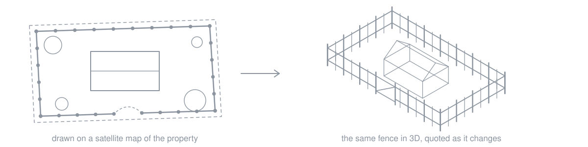

I'm a senior full-stack engineer in Kampala, Uganda. At Ergeon I built the 3D fence quoting tool.

### 3D fence quoting tool

Homeowners draw a fence on a satellite map of their own property, see it in 3D before booking, and get a quote that updates as they change the design. It increased quote conversions. Built in Three.js, React and TypeScript, with models of the whole fence catalog whose materials and dimensions match the specs.

### Working with AI agents

I use Claude Code and Codex every day, and nothing they write ships until I've reviewed it and it passes tests. I also build the tooling around that work: several Claude Code agents running in parallel, each in its own git worktree, each turning a ticket into a reviewed pull request, with an orchestrator that checks and merges.

React, TypeScript, Next.js, Three.js, Node.js, Python and Django, GraphQL, PostgreSQL, AWS.

[LinkedIn](https://www.linkedin.com/in/kayizzi-sulaiman) · [Email](mailto:sulaimanmoses13@gmail.com)
