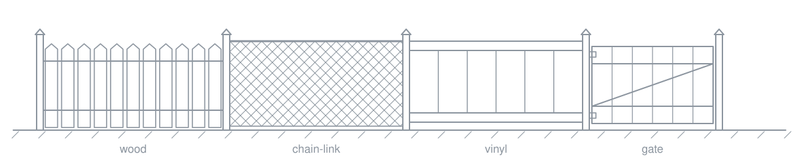

I'm a senior full-stack engineer in Kampala, Uganda.

For the past five years I've been at Ergeon, a US home improvement company, where I built the 3D fence quoting tool. Homeowners draw a fence on a satellite map of their own property, see it in 3D before booking, and get a quote that updates as they change the design. It increased quote conversions.

The work behind it: Three.js models of the whole fence catalog, with materials and dimensions that match the specs; React and TypeScript micro frontends that ship independently; lazy-loaded 3D and map code; and end-to-end tests on the quote and booking flows.

Ergeon is an AI-first team. I use Claude Code and Codex every day, and nothing they write ships until I've reviewed it and it passes tests. I also build the tooling around that work, at Ergeon and on my own: several Claude Code agents running in parallel, each in its own git worktree, each turning a ticket into a reviewed pull request, with an orchestrator that checks and merges.

I've also led the frontend team at Noq, an identity and access management SaaS, and done full-stack work at ShipOhi, Harmonic Labs, Knotel and Andela.

React, TypeScript, Next.js, Three.js, Node.js, Python and Django, GraphQL, PostgreSQL, AWS.

[LinkedIn](https://www.linkedin.com/in/kayizzi-sulaiman) · [Email](mailto:sulaimanmoses13@gmail.com)
