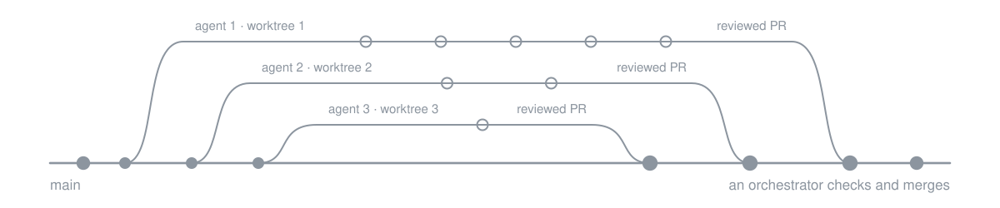
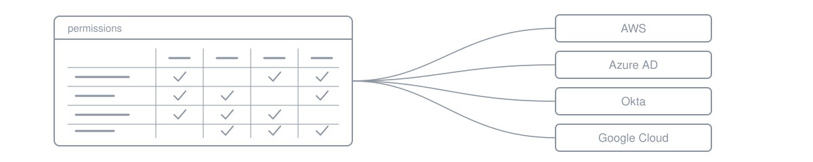
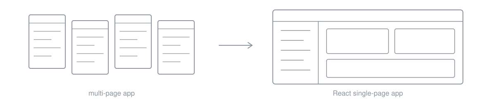

I'm a senior full-stack engineer in Kampala, Uganda. I've built production web apps for US companies, remotely, for 7+ years.

### Ergeon: the 3D fence quoting tool

Homeowners draw a fence on a satellite map of their own property, see it in 3D before booking, and get a quote that updates as they change the design. It increased quote conversions. I built it in Three.js, React and TypeScript, with models of the whole fence catalog (wood, chain-link, vinyl, gates, posts) whose materials and dimensions match the specs, micro frontends that ship independently, lazy-loaded 3D and map code, and end-to-end tests on the quote and booking flows. At Ergeon since 2021, Senior Software Engineer since 2024.

### Ergeon: working with AI agents

Ergeon is an AI-first team. I use Claude Code and Codex every day, and nothing they write ships until I've reviewed it and it passes tests. I also build the tooling around that work, at Ergeon and on my own: several Claude Code agents running in parallel, each in its own git worktree, each turning a ticket into a reviewed pull request, with an orchestrator that checks and merges.

### Noq: permissions across four clouds

I led the frontend of Noq's identity and access management platform, a UI that streamlines permissions across AWS, Azure AD, Okta and Google Cloud. I ran code reviews and architecture decisions for the frontend team, set up micro frontends, and added Cypress tests to the CI/CD pipelines. Part-time, 2022 to 2023.

### ShipOhi: from pages to a single-page app

I led the move from a multi-page application to a React single-page app, and improved performance by 30% through refactoring and more efficient data handling. Django and PostgreSQL on the backend. Part-time, 2019 to 2021.

Earlier: Harmonic Labs, Knotel and Andela.

React, TypeScript, Next.js, Three.js, Node.js, Python and Django, GraphQL, PostgreSQL, AWS.

[LinkedIn](https://www.linkedin.com/in/kayizzi-sulaiman) · [Email](mailto:sulaimanmoses13@gmail.com)
