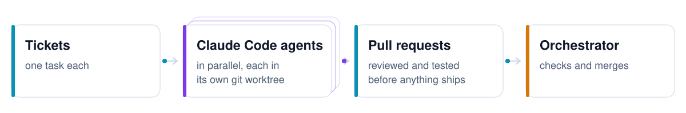
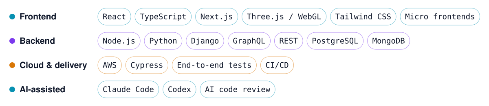

<picture>
  <source media="(prefers-color-scheme: dark)" srcset="assets/header-dark.svg">
  
</picture>

<h3 align="center">I build 3D product tools for the web, and I ship them with AI coding agents.</h3>

Kampala, Uganda · 7+ years building production web apps for US companies, remotely 
<a href="https://www.linkedin.com/in/kayizzi-sulaiman">LinkedIn</a> · <a href="mailto:sulaimanmoses13@gmail.com">sulaimanmoses13@gmail.com</a>

### What I build

<table>
<tr>
<td width="33%" valign="top">
 
<b>3D quoting on satellite maps</b> 
At Ergeon I built a Three.js tool where homeowners design a fence on their own property, see it in 3D before booking, and get a quote that updates as they change it. It increased quote conversions.
</td>
<td width="33%" valign="top">
 
<b>Fast, modular frontends</b> 
Micro frontends in React and TypeScript that ship independently. Code splitting and lazy loading for the heavy 3D and map modules. End-to-end tests over the quote and booking flows on every release.
</td>
<td width="33%" valign="top">
 
<b>Leading frontend work</b> 
I set Ergeon's frontend code-review standards, mentor engineers across a distributed team and serve as Scrum Master. I also led the frontend team at Noq, an identity and access management SaaS.
</td>
</tr>
</table>

### How I work with AI agents

<picture>
  <source media="(prefers-color-scheme: dark)" srcset="assets/ai-flow-dark.svg">
  
</picture>

Ergeon is an AI-first team. I use Claude Code and Codex every day for features, refactoring and tests, and nothing they write ships until I've reviewed it and it passes tests. I also build the tooling around that work, at Ergeon and on my own: several Claude Code agents in parallel, each in its own git worktree, each turning a ticket into a reviewed pull request, with an orchestrator that checks and merges.

### Stack

<picture>
  <source media="(prefers-color-scheme: dark)" srcset="assets/stack-dark.svg">
  
</picture>

### Experience

| When | Where | What |
| :--- | :--- | :--- |
| 2021 – now | **Ergeon** · Senior Software Engineer since 2024 | 3D quoting tool, micro frontends, AI-first engineering |
| 2022 – 2023 | **Noq** · Senior Software Engineer, part-time | Led the frontend of an IAM platform across AWS, Azure AD, Okta and Google Cloud |
| 2021 | **Harmonic Labs** · Software Engineer, part-time | Features in React and Node.js |
| 2019 – 2021 | **ShipOhi** · Full-Stack Engineer, part-time | Led the move from a multi-page app to a React single-page app |
| 2019 – 2020 | **Knotel** · Full-Stack Engineer, contract | Internal real estate operations tools |
| 2018 – 2020 | **Andela** · Software Engineer | Built and tested software from requirements to deployment |

Most of my work lives in private company repositories; the public ones here are earlier projects. B.Sc. Computer Science, Gulu University · AWS Cloud Developer Nanodegree, Udacity.
